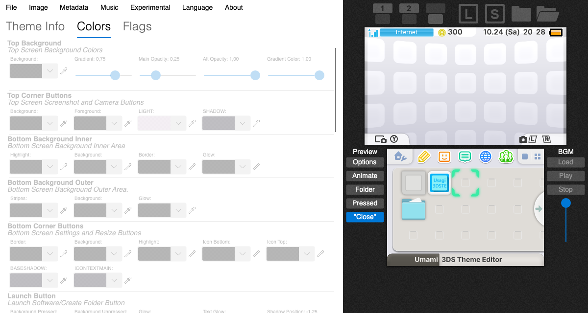
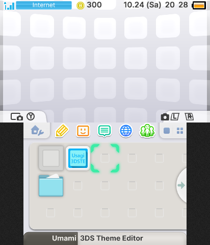
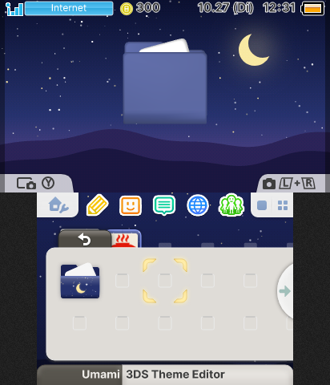
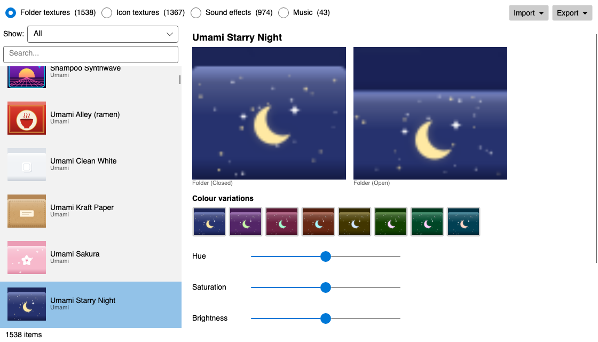

<div align="center">


# Umami 3DS Theme Editor

**Make custom themes for the Nintendo 3DS HOME Menu, on Windows, macOS and Linux.**

[](https://github.com/BakuretsuBaka/Umami-3DS-Theme-Editor/releases/latest)
[](https://github.com/BakuretsuBaka/Umami-3DS-Theme-Editor/releases)
[](https://github.com/BakuretsuBaka/Umami-3DS-Theme-Editor/actions/workflows/build.yml)
[](LICENSE)


[Download](#download) · [Features](#features) · [Building](#building) · [Credits](#credits)



</div>

Wallpapers, colours, folder and icon textures, sound effects and background music, with a live preview of both screens that
behaves like the real HOME Menu. Self-contained builds for **x64 and ARM64**, on **.NET 8**: nothing else to install.

> Umami is a fork of [usagirei/3DS-Theme-Editor](https://github.com/usagirei/3DS-Theme-Editor) (MIT). The original WPF /
> .NET Framework 4.5 application was ported to [Avalonia](https://avaloniaui.net/) and [SkiaSharp](https://github.com/mono/SkiaSharp);
> the theme format library is unchanged apart from the .NET 8 move.

## Download

Get the package for your system from the [**latest release**](https://github.com/BakuretsuBaka/Umami-3DS-Theme-Editor/releases/latest).

| System | File |
|---|---|
| Windows 10/11 (Intel/AMD) | `…-win-x64.zip` |
| Windows 11 on ARM | `…-win-arm64.zip` |
| macOS, Apple Silicon | `…-osx-arm64.dmg` |
| macOS, Intel | `…-osx-x64.dmg` |
| Linux (x86-64) | `…-linux-x64.tar.gz` |
| Linux (ARM64, e.g. Raspberry Pi 4/5) | `…-linux-arm64.tar.gz` |

<details>
<summary><b>macOS:</b> "the app is damaged" or "unidentified developer"</summary>

Open the `.dmg` and drag the app to *Applications*. The app is ad-hoc signed but not notarized (there is no paid Apple developer
account behind it), so macOS may refuse to open it at first. Fix it once with

```bash
xattr -dr com.apple.quarantine "/Applications/Umami 3DS Theme Editor.app"
```

or right-click the app and choose *Open*.
</details>

<details>
<summary><b>Linux:</b> requirements</summary>

Extract the archive and run `./UmamiThemeEditor`. It needs a desktop with X11 or XWayland, and `libfontconfig`.
For the *screen* eyedropper, install one of `grim`, `gnome-screenshot`, `spectacle`, `maim`, `scrot` or ImageMagick `import`
(without one, colour picking is limited to the editor window).
</details>

## Features

### Live preview

<table>
<tr>
<td width="50%"></td>
<td width="50%"></td>
</tr>
<tr>
<td align="center"><sub>The HOME Menu with the theme applied</sub></td>
<td align="center"><sub>Opening a folder</sub></td>
</tr>
</table>

* **Interactive, like the console:** click an icon to move the cursor, click it again (or press *Open*) to open a folder or launch it,
  flip wallpaper pages with the arrow button, and leave a folder with *Close* / back. Buttons show their pressed state while you hold
  them, the cursor slides, and folders open with a short transition. Arrow keys, Enter and Esc work too.
* **Zoom and swipe:** the two buttons in the top-right corner switch between 1 and 6 rows of icons (or `+` / `−`), and dragging the
  icons sideways flips pages. In the one-row layout the selected title's name appears in a bubble, in the theme's *Game Text* colours.
* **Hear it:** the theme's own **sound effects** play as you click around (cursor, launch, folder, close, page flips, lid), and
  there is a *Lid* button. Animated wallpapers can be toggled.
* **Drop to apply:** drop an image straight onto the top or bottom screen to use it as the wallpaper, or a theme anywhere in the window to open it.

### Editing

* **Undo / redo** for every edit: colours, flags, textures, sound effects and the theme info
  (*Edit* menu, `Ctrl/Cmd+Z`, `Ctrl/Cmd+Shift+Z` or `Ctrl+Y`).
* **Never lose work:** the title bar marks unsaved changes with `*`, and New, Open and closing the window ask before discarding them.
* **Images of any size:** pictures that don't have the exact texture size are fitted for you, by *crop to fill* or *stretch*.
  The editor picks the wide or the single-screen layout from the image's shape.
* **Colours and Flags tabs:** collapsible colour sets, a filter box to find a setting fast (`Esc` clears it), and
  *Copy all colors* / *Paste colors* in a colour set's right-click menu to move a whole colour scheme between sets or themes.
* **Image palette:** pick colours from the (up to) 20 most used colours of the wallpapers, or with the eyedropper from anywhere on screen.
* **Status bar:** where the theme is saved, whether there are unsaved changes, and the music / sound effect sizes against the HOME
  Menu limits (orange when over).
* Every top/bottom render mode and frame type, folder and icon colours and textures, image dithering and edge bleed, and
  **SMDH** (`info.smdh`) generation.

### Resource library



* Ready-made **folder textures, icon textures, sound effect sets and music**, applied to the open theme with one click, with search,
  audio preview and **colour variations** (hue / saturation / brightness, plus 8 one-click hue presets) for textures.
* **Build your own:** *Add themes folder...* imports everything from a folder of theme ZIPs or theme folders. Textures and sound
  effects are de-duplicated and music is copied in, so the library is self-contained and the source ZIPs can be deleted afterwards.
* **Share:** export and import resources as `.umamipack` files (validated on import) or as plain files (BCSTM, sound BIN, PNG textures).
* **Tidy up:** *Show* lists everything, only the built-in presets, or only your own imports. Your own items can be removed one by one,
  and *Import → Free Up Space...* deletes your imports, or everything including the built-in presets. (On macOS the presets live
  inside the signed app, so there they are hidden instead of deleted.)

### Music and sound effects

* **BGM conversion:** *Music → Import Audio* turns **WAV, MP3, OGG, BCSTM, BFSTM, BRSTM, BCWAV, DSP, IDSP, ADX** and **HPS** into a
  theme-ready `BGM.BCSTM` (DSP-ADPCM or PCM16, mono mix-down, resampling, loop points), checks the 3 MB HOME Menu limit,
  and exports the music as WAV or BCSTM again.
* **CWAV sound-effect manager:** converts WAV / MP3 / OGG to CWAV itself; no external `ctr_WaveConverter` or `vgmstream` needed.
* **In-app playback** on every platform (OpenAL Soft).

### Saving and sharing

* **Theme ZIP:** *File → Export Theme ZIP* (`Ctrl/Cmd+E`) writes a Theme Plaza / Themezer ready package (theme, music, icon,
  a fresh preview and the name). Open or drop such a ZIP to unpack and load it.
* **Send to CHMM2:** push the theme to the console over the network.
* **Fast saving:** the LZ11 compressor finds matches with a hash chain instead of a brute-force search, about 50× faster with
  byte-identical output, so saving, exporting and sending never freeze the window.
* Saving also writes a fresh `preview.png` and `info.smdh` next to the theme.
* Remembers the window size and the last folder, *File → Show in File Manager*, and a recent files list
  (*Clear List*; entries whose file is gone are removed when clicked).

### Languages

English, Deutsch, Español, Français, Italiano, Nederlands, Polski, Português (Brasil), Svenska, Türkçe, Русский, 日本語, 한국어,
简体中文 and 繁體中文 (*Language* menu, takes effect on the next start).

## Building

Requires the [.NET 8 SDK](https://dotnet.microsoft.com/download/dotnet/8.0).

```bash
dotnet build Umami3DSThemeEditor.sln
dotnet test  Umami3DSThemeEditor.sln
dotnet run --project src/ThemeEditor.App
# packages for all platforms:
bash packaging/package.sh 2.0.0
```

| Path | Contents |
|---|---|
| `src/ThemeEditor.Common` | Theme / SMDH / texture / LZ11 library, `Audio/BcstmConverter`, `Audio/CwavConverter` |
| `src/ThemeEditor.App` | Avalonia UI (the previews are rendered with SkiaSharp in `Previews/`) |
| `tests/ThemeEditor.Tests` | xUnit tests, including headless UI renders |
| `tools/` | `make_resx.py` / `gen_resources.py`: the localization pipeline (`tools/i18n/*.txt`) |

### Adding or improving a translation

Edit or create `tools/i18n/<culture>.txt` (`Key=Value`, `\n` for a line break; missing keys fall back to English), then run

```bash
python3 tools/make_resx.py && python3 tools/gen_resources.py
```

New languages must also be added to `MainWindow.Languages`. Most translations were machine-assisted, so corrections from
native speakers are very welcome.

<details>
<summary><b>Notes on the port</b></summary>

* WPF's pixel shader (`WarpEffect`) and `Viewport3D` don't exist outside Windows, so the animated top-screen pattern is a CPU port
  of the shader, and the 3D folder is drawn by a small software rasteriser.
* The original in-place self-updater was removed; the editor only *notifies* about new releases.
* Settings live in `~/.config/UmamiThemeEditor/settings.json` (Linux/macOS) or `%AppData%\UmamiThemeEditor\settings.json` (Windows).
</details>

## Credits

* **Usagirei**: original 3DS Theme Editor (MIT)
* **Reisyukaku**: [YATA] (LZ11, texture decoding) · **kwsch**: [pk3DS] · **Barubary**: [DSDecmp]
* **3dbrew**: [file format documentation](https://www.3dbrew.org/wiki/)
* **VGAudio** (Alex Barney, MIT): BCSTM / DSP-ADPCM · **NLayer**, **NVorbis**: MP3 / OGG decoding
* **Avalonia**, **SkiaSharp**, **OpenAL Soft** (via Silk.NET)
* **beelzy**: [Kame Editor] (GPL-3.0) inspired the collapsible colour sets and copying colour schemes between sets.
  No Kame Editor code is included: it is C++/Qt, and copying GPL code would require relicensing this MIT project under the GPL,
  so the ideas were implemented from scratch.

[YATA]:https://github.com/Reisyukaku/YATA
[DSDecmp]:https://github.com/Barubary/dsdecmp/tree/master/CSharp/DSDecmp
[pk3DS]:https://github.com/kwsch/pk3DS/blob/master/pk3DS/3DS/LZSS.cs
[Kame Editor]:https://gitlab.com/beelzy/kame-editor

## License

MIT, see [LICENSE](LICENSE). Original © 2016 Usagirei; modifications © 2026 Umami contributors.
